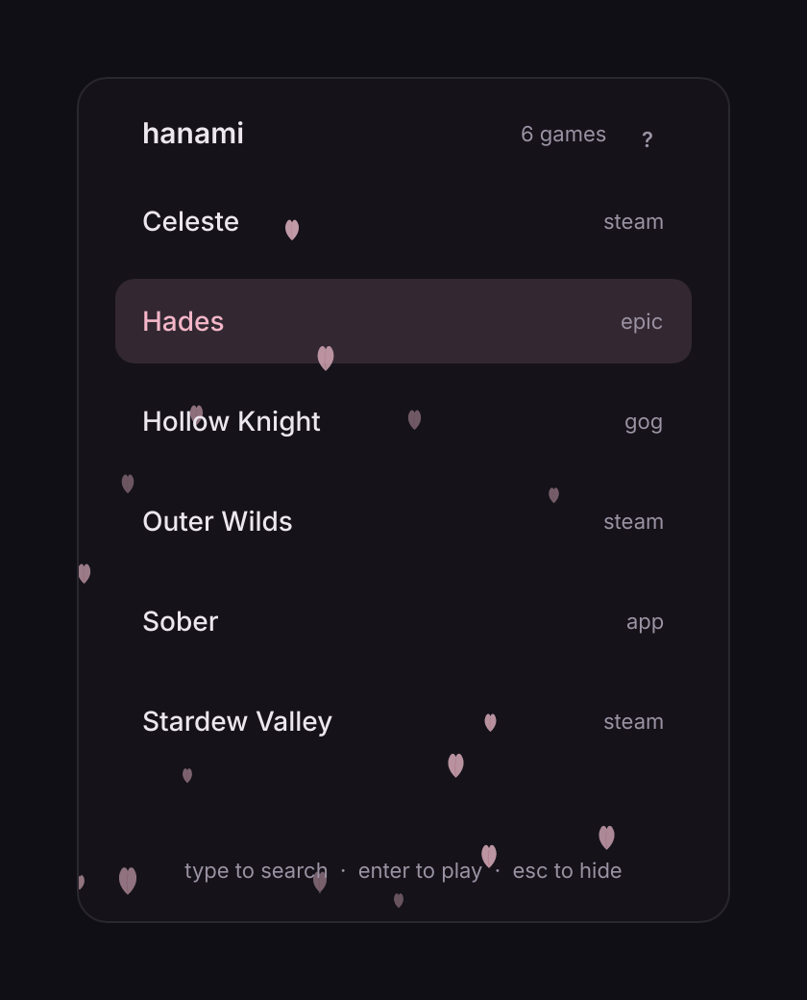

# Hanami

<p align="center"></p>

A game launcher for Linux and Windows. It runs in the system tray and
opens a small panel that lists your installed games.

- **Game detection:** Steam, Heroic (Epic, GOG, Amazon), Lutris and desktop
  entries on Linux; Steam, Epic and GOG on Windows. Other programs can be
  added in the settings file.
- **Resource use:** about 30 MB of memory, no CPU use while hidden.
- **Controls:** `Ctrl+Alt+H` or the tray icon opens the panel; type to
  filter, Enter to launch.
- **AI help prompt:** the **?** button copies a prompt containing the full
  documentation, for AI assistants that can read your computer (Claude Code,
  OpenCode and similar) to answer questions about Hanami.

## Install

Download the newest version from
[Releases](https://github.com/sjdsjadjajdjsa/hanami/releases):

- **Linux:** `hanami-linux-x86_64.tar.gz`. Unpack it and run `hanami`.
- **Windows:** `hanami-windows-x86_64.zip`. Unpack it and run `hanami.exe`.

To start it with your computer, add `hanami --hidden` to your startup
programs ([how](GUIDE.md#starting-with-the-computer)).

## Use

- **Open and close:** `Ctrl+Alt+H`, a click on the tray icon, or
  `hanami --toggle` (bind that to a key on Wayland).
- **Pick a game:** type to search, arrows and Enter, or click.
- **Settings:** tray icon, Edit settings. Everything they can hold is in
  [GUIDE.md](GUIDE.md).

## Build from source

Needs [Rust](https://rustup.rs). On Linux, also the development packages
for xkbcommon, fontconfig, Wayland and D-Bus (on Debian and Ubuntu:
`libxkbcommon-dev libfontconfig1-dev libwayland-dev libdbus-1-dev`).

```
cargo build --release
./target/release/hanami
```

[SPEC.md](SPEC.md) says what Hanami does, [DESIGN.md](DESIGN.md) how it
looks, and [ROADMAP.md](ROADMAP.md) what comes next. The website is in
[site/](site), and `hanami --snapshot picture.png` redraws the screenshots.

## License

Hanami is free software under the [GNU GPL, version 3 or later](LICENSE).
It is built with [Slint](https://slint.dev) and ships the
[Inter](https://rsms.me/inter/) typeface (SIL Open Font License, in
`assets/Inter-LICENSE.txt`).
