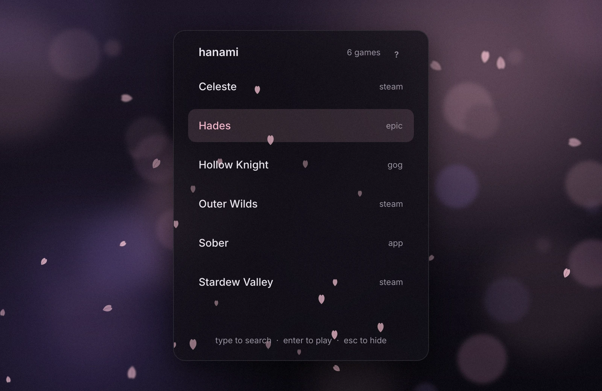
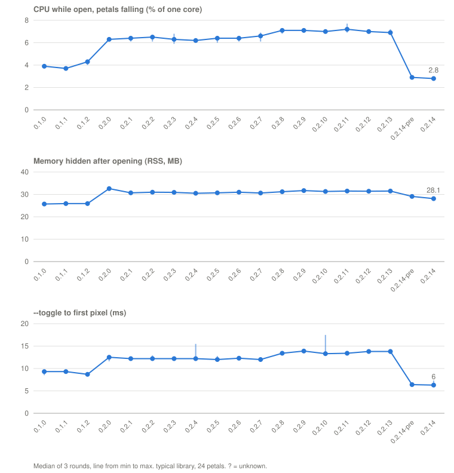

# Hanami

<p align="center">
  <a href="https://github.com/sjdsjadjajdjsa/hanami/releases/latest"></a>
  <a href="https://github.com/sjdsjadjajdjsa/hanami/actions/workflows/ci.yml"></a>
  <a href="LICENSE"></a>
  
</p>

<p align="center">
  <picture>
    <source media="(prefers-color-scheme: light)" srcset="docs/screenshot-light.webp">
    
  </picture>
</p>

A game launcher for Linux and Windows. It runs in the system tray and
opens a small panel that lists your installed games.

- **Game detection:** Steam, Heroic (Epic, GOG, Amazon), Lutris and desktop
  entries on Linux; Steam, Epic, GOG and Heroic on Windows. Each game shows
  its own icon.
- **Ports and rewrites:** finds known ports, recomps and rewrites (Ship of
  Harkinian, Zelda 64: Recompiled, OpenMW and more, listed in
  [ports.toml](ports.toml)) and, if you want, Rust games you built yourself.
  New finds wait for a yes before they join the list.
- **Minecraft:** Prism Launcher (or PolyMC, MultiMC) is one row that opens
  to its instances; the launcher starts them and handles the Microsoft login.
- **Your list:** pin games to the top, rename or hide them, add any program
  with **+**. Games you played last come first.
- **Controls:** `Ctrl+Alt+H` or the tray icon opens the panel; type to
  search (first letters and small typos work too), Enter to launch, Tab or
  right-click for more. A game controller works too: hold Start and Select.
- **Your look:** colours and the falling petals are two small files;
  write them yourself or ask your AI for "autumn, with maple leaves"
  ([how](GUIDE.md#changing-the-look)).
- **Light:** about 28 MB of memory with 200 games, and under 3 % of one
  core while the panel is open. See [Performance](#performance).
- **Problems:** **Report a problem** in the tray menu opens a filled-in
  GitHub issue, with what went wrong if Hanami crashed. Nothing is sent
  until you press Submit.
- **AI help prompt:** the **?** button copies a prompt containing the full
  documentation, for AI assistants that can read your computer (Claude Code,
  OpenCode and similar) to answer questions about Hanami.

Website: <https://hanami.lilygrove.dev>

## Performance



With 200 games, 0.2.14 uses under 3 % of one core with the panel open and
28 MB of memory, and opens in 6 ms. [docs/benchmarks.md](docs/benchmarks.md)
has every release, how it was measured, and how to run it yourself.

## Install

Download the newest version from
[Releases](https://github.com/sjdsjadjajdjsa/hanami/releases/latest).

| | Download | Notes |
|---|---|---|
| **Linux** | `hanami-x86_64.AppImage` | Mark it executable (right-click, Properties, or `chmod +x`) and run it. Needs a distribution from 2022 or newer (Ubuntu 22.04, Fedora 36, Mint 21, Arch, and so on). |
| **Windows** | `hanami-setup-x86_64.exe` | Installs for your user only, with no admin rights. Adds a Start menu entry and, if you tick the box, starts Hanami with Windows. |

Windows will say the publisher is unknown, as the installer isn't signed:
click "More info", then "Run anyway". If you don't want an installer, there
are also `hanami-linux-x86_64.tar.gz` and `hanami-windows-x86_64.zip` with
the plain program.

Each release also has a `SHA256SUMS` file and a signed record of how every
file was built; [SECURITY.md](SECURITY.md) says how to check a download and
how to report a security problem.

Hanami says in its tray menu when a newer version is out; it never updates
itself. To start it with your computer, pick **Open at login** in the tray
menu.

## Use

- **Open and close:** `Ctrl+Alt+H`, a click on the tray icon, or
  `hanami --toggle`.
- **Move it:** on Windows, hold Alt or the Windows key and drag; on Linux,
  your desktop's own key for moving windows does it.
- **Pick a game:** type to search, arrows and Enter, or click.
- **More for one game:** Tab or right-click: Pin to top, Rename, Hide.
- **Add a game:** the **+** button.
- **Settings:** tray icon, Edit settings. Everything they can hold is in
  [GUIDE.md](GUIDE.md).

## Build from source

Needs [Rust](https://rustup.rs). On Linux, also the development packages
for xkbcommon, fontconfig, Wayland, D-Bus and udev (on Debian and Ubuntu:
`libxkbcommon-dev libfontconfig1-dev libwayland-dev libdbus-1-dev libudev-dev`).

```
cargo build --release
./target/release/hanami
```

More in [docs/](docs): [SPEC.md](docs/SPEC.md) says what Hanami does,
[DESIGN.md](docs/DESIGN.md) how it looks, [ROADMAP.md](docs/ROADMAP.md) what
comes next, and [PORTS.md](docs/PORTS.md) how to add a port. To help out, see
[CONTRIBUTING.md](CONTRIBUTING.md). The website is in [site/](site). The
README pictures and the short videos are made by the scripts in
[docs/video](docs/video/README.md).

## License

Hanami is free software under the [GNU GPL, version 3 or later](LICENSE).
It is built with [Slint](https://slint.dev) and ships the
[Inter](https://rsms.me/inter/) typeface (SIL Open Font License, in
`assets/Inter-LICENSE.txt`). The maple leaf and snowflake examples in the
guide are from Microsoft's
[Fluent Emoji](https://github.com/microsoft/fluentui-emoji) (MIT).
